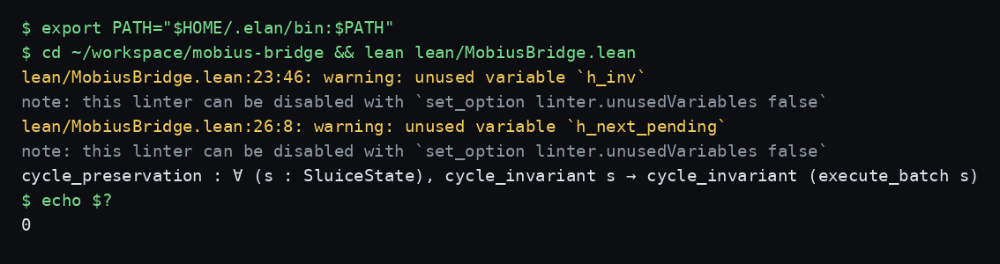
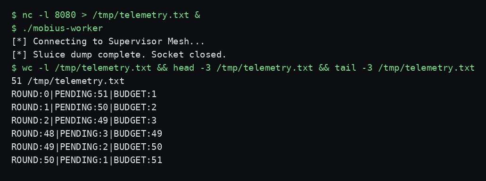

# MobiusBridge

I built this to pin down one specific failure mode: a ReAct-style agent loop
where a prompt injection keeps the orchestrator's execution budget topped up,
so the loop never times out. I model that loop as a tiny state machine, prove
the invariant it violates in two separate proof systems, and then wire one of
those proofs into the compiler so the binary cannot be built unless the
invariant holds.

The name comes from the shape of the thing. The loop feeds back into itself,
and the budget refresh twists the termination condition the way a Möbius strip
twists a surface. The code is small on purpose. Every file below is one I have
read, and everything I claim here I checked against the code or by running it.

## What it models

A ReAct loop runs in rounds. Each round picks up a pending module, does the
work, and spends budget. Normally the budget runs out and the loop halts. The
attack this repo models is cycle-stealing: an injected prompt refreshes the
synthetic token budget every round, so the budget never hits zero, and the
loop keeps chewing through its queue past its timeout.

The state is three numbers:

- `round` — how many batches have run.
- `pending_modules` — how much work is left in the queue.
- `synthetic_budget` — the orchestrator's execution budget.

One step, `execute_batch`, does three things: `round + 1`,
`pending_modules - 1`, `synthetic_budget + 1`. The last one is the exploit.
Real work decrements the queue. The injection increments the budget.

The Cycle-Stealing Invariant says: if there is still work in the queue, the
budget must be greater than zero. That sounds like a safety property. It is
really a description of the attack: after the injection, the invariant holds
forever, which means the timeout — the thing that was supposed to stop the
loop — can never fire. The proof below does not show the loop is safe. It
shows the loop cannot stop on budget grounds. Read it that way and the whole
repo makes sense.

## Layout

```
mobius-bridge/
├── README.md                 # this file
├── LICENSE                   # SNAPKITTY OPAQUE SOURCE LICENSE v1.0
├── .gitignore
├── mobius-bridge.cabal       # the Haskell package: executable mobius-worker
├── Dockerfile                # Alpine builder -> FROM scratch static binary
├── src/
│   ├── Main.hs               # IO shell: TCP telemetry streamer
│   ├── MobiusBridge.hs       # the invariant as Liquid Haskell refinement types
│   └── Quaternion.hs         # 4D state vector + Hamilton product (standalone)
├── lean/
│   └── MobiusBridge.lean     # the invariant as a Lean 4 theorem
├── supervisor/
│   ├── README.md             # supervisor-specific run notes
│   ├── mix.exs               # Mix project, one dep: file_system
│   └── lib/
│       ├── codex_supervisor/
│       │   └── tcp_receiver.ex        # TCP listener, appends lines to the inbox log
│       └── dev_flow_twin/
│           ├── telemetry_ingester.ex  # inotify watcher, byte-cursor log reader
│           └── spatial_graph.ex       # binary quaternion stream parser
└── docs/
    ├── lean-check.png        # real terminal screenshot: Lean check
    └── worker-telemetry.png  # real terminal screenshot: worker demo
```

No loose source files at the root. The Haskell sources used to sit at the
root; I moved them into `src/` and pointed `hs-source-dirs` at it. The
`.cabal`, the `Dockerfile`, and the supervisor README all reference the new
paths. The build still works after the move — I verified it with a clean
rebuild, details in the verification section below.

## The Lean proof — `lean/MobiusBridge.lean`

This is the whole proof, and it is short. The file is 48 lines. I will walk
through it exactly as written.

`SluiceState` is a structure with three `Nat` fields: `round`,
`pending_modules`, `synthetic_budget`. `Nat` matters: subtraction saturates
at zero, so `0 - 1 = 0`, never negative. That matches the Haskell side,
where I had to write the saturation out by hand.

`cycle_invariant` is the invariant as a proposition:
`pending_modules > 0 → synthetic_budget > 0`. If work remains, budget
remains.

`execute_batch` is the transition. It returns a new state with `round + 1`,
`pending_modules - 1`, `synthetic_budget + 1`.

`cycle_preservation` is the theorem: for any state `s`, if `cycle_invariant
s` holds, then `cycle_invariant (execute_batch s)` holds. The proof is three
moves: introduce the assumption that the next state still has pending work,
unfold `execute_batch`, and close with `Nat.zero_lt_succ` — the successor of
any natural number is greater than zero. The new budget is
`s.synthetic_budget + 1`, which is a successor, so it is greater than zero.
Done.

Then two concrete checks. One: the state `{round := 0, pending_modules :=
3, synthetic_budget := 5}` satisfies the invariant, proved by `decide`.
Two: two exploit steps in a row still preserve the invariant, by applying
`cycle_preservation` twice. The file ends with `#check
@cycle_preservation`, which prints the theorem's type.

Here is the honest part. Lean's linter flags two unused variables in this
proof: `h_inv` (the hypothesis that the starting state satisfies the
invariant) and `h_next_pending` (the assumption that the next state still
has pending work). The proof never uses either one. That is not a bug in
the proof — it is the point, stated plainly: the new budget is
`old_budget + 1`, which is positive no matter what the old state was. The
invariant holds after the step unconditionally, not because the starting
state was good. The injection does not preserve a fragile property. It
manufactures the property on every step. If you are reading this proof
looking for a safety guarantee, you have it backwards: the theorem proves
the loop cannot be stopped by budget exhaustion.

I re-ran this check myself during this rewrite. Real output:

```
$ lean lean/MobiusBridge.lean
lean/MobiusBridge.lean:23:46: warning: unused variable `h_inv`
note: this linter can be disabled with `set_option linter.unusedVariables false`
lean/MobiusBridge.lean:26:8: warning: unused variable `h_next_pending`
note: this linter can be disabled with `set_option linter.unusedVariables false`
cycle_preservation : ∀ (s : SluiceState), cycle_invariant s → cycle_invariant (execute_batch s)
$ echo $?
0
```

Exit 0. The two warnings are linter noise about the unused hypotheses, and
I keep them in the screenshot because they are part of the real story.



## The Liquid Haskell version — `src/MobiusBridge.hs`

Same theorem, restated as refinement types, checked by an SMT solver (Z3)
at compile time. The file is 100 lines.

`SluiceState` is a Haskell record with three `Int` fields: `round`,
`pendingModules`, `syntheticBudget`. The fields are `Int`, not `Nat` —
`Nat` is a Liquid Haskell refinement alias (`{v:Int | 0 <= v}`), not a
Haskell type, so it cannot appear as a field type. A refinement on the
data declaration constrains all three fields to be non-negative. That
distinction cost a compile error when the file first used `Nat` as a field
type; the fix is labeled in the file.

`CycleInvariant` is a Liquid predicate: `pendingModules S > 0 =>
syntheticBudget S > 0`. `GoodState` is the refined type of states
satisfying it.

`executeBatch :: GoodState -> GoodState` is the theorem. The type IS the
preservation claim: feed in a state satisfying the invariant, get one back
that satisfies it. The body mirrors Lean, with one difference I had to
write out explicitly: Haskell `Int` subtraction does not saturate, so the
pending count uses an `if` — if it is already 0, stay at 0, else subtract
1. Without that guard, the output could go negative and violate the `Nat`
refinement.

`executeBatchTwice :: GoodState -> GoodState` composes the step with
itself. `testState` is the concrete `{round = 0, pendingModules = 3,
syntheticBudget = 5}` state, typed as `GoodState`. `testBatch` is one
`executeBatch` applied to it, also typed `GoodState`.

The file carries the GHC plugin pragmas at the top:
`-fplugin=LiquidHaskell` with `--no-termination`. That is the gate. When
GHC compiles this module, the plugin runs the SMT solver over the
refinement types. If the solver cannot prove the `GoodState -> GoodState`
implication, GHC halts the build and no object file is emitted. The build
does not run a separate checker after the fact. Compilation itself is the
check.

Two assistant-added fixes are labeled in the file, and I keep the labels.
`import Prelude hiding (round)` exists because the record field `round`
clashes with Prelude's `round` rounding function. The `Nat` refinement
block exists because of the field-type issue above. Nothing else in the
file is scaffolding. The theorem code is the user's.

## The IO shell — `src/Main.hs`

`Main.hs` is the impure shell around the verified core. 54 lines. It does
exactly four things: connect, stream, recurse, close.

`connectSupervisor` opens a raw TCP connection to a host and port using
`Network.Socket`. `main` calls it with `"127.0.0.1"` and `"8080"` —
hardcoded. There is no config file, no flag, no environment variable, no
retry, no TLS, and no authentication. If nothing is listening, `connect`
throws and the program dies. I verified that failure mode by running the
binary with no listener:

```
[*] Connecting to Supervisor Mesh...
mobius-worker: Network.Socket.connect: <socket: 17>: does not exist (Connection refused)
```

Exit code 1. Start the listener first. Always.

`runSluiceDump` takes a socket and a state, serializes the state as one
line — `ROUND:<n>|PENDING:<n>|BUDGET:<n>` followed by a newline — sends it
with `sendAll`, computes the next state with `executeBatch`, and recurses
unless the next state's pending count is zero. The recursion is the whole
run: it walks the state machine to completion over the socket.

`main` prints `[*] Connecting to Supervisor Mesh...`, connects, runs the
dump from the initial state `{round = 0, pendingModules = 51,
syntheticBudget = 1}`, closes the socket, and prints `[*] Sluice dump
complete. Socket closed.`

One line in this file is an assistant-added fix, labeled as such in the
source: the Liquid annotation `{-@ runSluiceDump :: Socket -> GoodState
-> IO () @-}`. Without it, the call `executeBatch state` fails the
checker, because `executeBatch` requires a `GoodState` and a plain
`SluiceState` does not establish the invariant. The annotation is the
promise that the state handed in satisfies the invariant. `main` keeps
that promise by starting from a state that does — 51 pending, budget 1 —
and every step after that goes through `executeBatch`, which preserves it.

## The quaternion module — `src/Quaternion.hs`

15 lines. `QState` is a 4D vector of `Double`s: real, i, j, k.
`entangle` is the Hamilton product — non-commutative state fusion, with
the standard component formulas (real part `a1*a2 - b1*b2 - c1*c2 -
d1*d2`, and the three imaginary parts with their cross terms).

Honest status: nothing in this repo calls `entangle`. I grepped. `Main.hs`
does not import `Quaternion`. The Elixir side has its own quaternion
parsing and does not call this module either. `Quaternion.hs` is listed
in the `.cabal` as an `other-module`, so it compiles as part of the
package, and it was previously reported `SAFE (0 constraints)` by the
Liquid checker — zero constraints because there are no refinements on it.
It is a building block with no consumer yet. I am not going to dress it
up as wired-in. When something calls it, the README will say so.

The `module Quaternion` line itself is assistant-added scaffolding so the
file compiles as a module. The `QState` type and `entangle` are the user's
code, verbatim.

## The package — `mobius-bridge.cabal`

One executable, `mobius-worker`. `main-is: Main.hs`, `other-modules:
MobiusBridge, Quaternion`, `hs-source-dirs: src` (this changed in the
reorg; it used to be `.`). `default-language: Haskell2010`. Build
depends: `base >= 4`, `bytestring`, `liquidhaskell`, `network`. The
`liquidhaskell` dependency is load-bearing: GHC needs it to load the
`-fplugin=LiquidHaskell` plugin at compile time.

The GHC options are the gate plus the static build:
`-fplugin=LiquidHaskell`, `-fplugin-opt=LiquidHaskell:--no-termination`,
`-O2`, `-static`, `-threaded`, `-rtsopts`, `-with-rtsopts=-N`. The C and
linker options are `-static` and `-static -pthread`. The emitted binary
is a statically linked ELF, about 5.1 MB.

Package metadata is real: author Ahmad Ali Parr, maintainer
ahmad.parr@snapkittywest.com, license
`LicenseRef-Sovereign-Leviathan-SL-AGPL3-001` with `LICENSE` as the
license file. I checked for placeholder metadata (`example@example.com`,
`TODO`, `FIXME`) across the repo during the reorg and found none. The
package header and `build-depends` are assistant-added scaffolding —
the minimal fields a valid `.cabal` file needs — and the file says so.
The executable stanza is the user's.

## The Docker image — `Dockerfile`

Two stages. Stage one: `alpine:3.19` as builder, installs `ghc cabal
musl-dev gmp-dev z3 build-base linux-headers`, copies the tree, runs
`cabal update && cabal build --enable-executable-static`, and copies the
built binary out. Stage two: `FROM scratch`, copies in just the static
binary, `ENTRYPOINT ["/mobius-worker"]`.

I did not verify this. Docker is not available on the machine I used for
this rewrite, so the Docker build has never run here. The Dockerfile is
plausible — the builder installs exactly what the Liquid gate needs
(GHC, Cabal, Z3) — but plausible is not verified, and I will not claim
the image builds until someone runs `docker build` on a machine with
Docker. Same for the `FROM scratch` runtime: the binary is statically
linked, so it should run with no libraries, but "should" is doing work
in that sentence and I am marking it as such.

## The supervisor — `supervisor/`

Elixir. Three modules, one Mix project. This is the receiving end of the
worker's TCP stream, plus a separate binary ingestion path. Read the
supervisor README for run notes; here is what each module actually does
and does not do.

### `CodexSupervisor.TcpReceiver` — `lib/codex_supervisor/tcp_receiver.ex`

A GenServer. On init it opens a `:gen_tcp` listener on the given port
with line-based framing (`packet: :line`), creates the inbox directory,
and starts accepting. Each accepted connection gets a lightweight `Task`
that loops on `:gen_tcp.recv`: every line received is appended verbatim
to `inbox/devFlow-finance-twin/telemetry.log`. When the worker closes
the socket, the task logs `Worker stream closed cleanly. Batch complete.`

What it does not do: verify anything. The startup log line says
"Supervisor listening for verified Haskell workers", but there is no
verification in the code. No handshake, no token, no allowlist, no
parsing. Any TCP client that connects to the port can append arbitrary
lines to the inbox log. If you expose this port beyond localhost, that
is your problem, and this paragraph is the warning. The receiver trusts
the network. The old README's phrase "accepts verified workers" was
wrong and I am correcting it here.

The inbox path is relative: `inbox/devFlow-finance-twin/telemetry.log`
under whatever directory the Elixir process runs from. The `.gitignore`
ignores `inbox/`, so telemetry logs never land in git.

### `DevFlowTwin.TelemetryIngester` — `lib/dev_flow_twin/telemetry_ingester.ex`

A GenServer. On init it creates the inbox directory, subscribes to
`FileSystem` (inotify) events on it, and records the log file's current
byte size as its starting offset — it deliberately does not re-read
history on boot. On each `:modified` event for `telemetry.log`, it opens
the file, seeks to its stored cursor, reads only the new bytes, advances
the cursor by the byte count, and hands the new data to
`dispatch_to_twin`.

`dispatch_to_twin` splits on newlines and logs each line at debug level:
`[Twin Ingest] Processed: <line>`. That is all it does. The comment
inside it says this is where you would parse the
`ROUND:1|PENDING:50` payload and cast it into an ASP solver or state
ledger. There is no ASP solver in this repo. There is no state ledger in
this repo. There is no parser. The hook is a comment and a log line.
When someone wires in a real consumer, that is a real change, and it
will need its own verification.

### `DevFlowTwin.SpatialGraph` — `lib/dev_flow_twin/spatial_graph.ex`

The binary ingestion path, separate from the text telemetry log.
`extract_quaternion/1` parses a binary of 4 native 64-bit floats
(`a, b, c, d`), passes each quaternion to
`update_digital_twin_spatial_graph/4`, and recurses over the rest until
the binary is empty. `ingest(binary)` is the entry point.

`update_digital_twin_spatial_graph/4` is an assistant-added stub. The
user's code calls it but does not define it, so the stub logs the
quaternion at debug level and returns `:ok`. It exists so the module
compiles. There is no spatial graph in this repo — no nodes, no edges,
no 4D map. The name describes the intended destination, not something
implemented. Nothing in the repo calls `ingest`, either. I grepped: no
in-repo caller. It is a parser with a logging stub, waiting for a real
consumer.

### `mix.exs`

Minimal Mix project: app `:codex_supervisor`, version `0.1.0`, Elixir
`~> 1.14`, `extra_applications: [:logger]`, one dependency:
`{:file_system, "~> 1.0"}`. The scaffolding comment in the file labels
it assistant-added. The three Elixir modules are the user's, verbatim,
except the labeled stub in `SpatialGraph`.

Note what is missing: there is no `Application` module and no
supervision tree. You start the GenServers by hand in IEx with
`start_link`. Nothing restarts them if they crash. The name
"supervisor" in the directory is the intent, not the OTP structure.

## Demo — the worker, for real

I ran the freshly built binary (built from `src/` after the reorg,
Liquid gate SAFE, see the verification note) against a plain `nc`
listener on port 8080. The Elixir receiver was NOT running — Elixir and Mix are not
available on the machine I used — so `nc` stood in for the TCP endpoint.
That exercises the worker end exactly: same binary, same port, same
wire format. It does not exercise the Elixir side. The end-to-end loop
(worker -> receiver -> log -> ingester) has never run anywhere in this
repo's history, as far as the record shows. Do not mistake this demo for
it.

Real output — commands and results as run, with one explanatory comment on the first line:

```
$ nc -l 8080 > /tmp/telemetry.txt &   # stand-in listener (Elixir receiver NOT run)
$ ./mobius-worker
[*] Connecting to Supervisor Mesh...
[*] Sluice dump complete. Socket closed.
$ wc -l /tmp/telemetry.txt && head -3 /tmp/telemetry.txt && tail -3 /tmp/telemetry.txt
51 /tmp/telemetry.txt
ROUND:0|PENDING:51|BUDGET:1
ROUND:1|PENDING:50|BUDGET:2
ROUND:2|PENDING:49|BUDGET:3
ROUND:48|PENDING:3|BUDGET:49
ROUND:49|PENDING:2|BUDGET:50
ROUND:50|PENDING:1|BUDGET:51
```

51 lines. First state: round 0, 51 pending, budget 1. Last state: round
50, 1 pending, budget 51. Every line increments the round by 1,
decrements pending by 1, increments budget by 1 — exactly the
`execute_batch` transition, streamed over a socket. The run ends when
the next state would have zero pending, so the worker stops instead of
sending a `PENDING:0` line. That boundary is worth noticing: the
telemetry shows the loop draining its queue, and the budget climbing the
whole way. The invariant held on every line, because the budget never
went down.



And the failure mode, also real: with nothing listening on 8080, the
worker prints the connecting line, throws `Connection refused`, and
exits 1. No retry. No fallback. The supervisor must be up first.

## How to run it

### Lean proof

```
export PATH="$HOME/.elan/bin:$PATH"
lean lean/MobiusBridge.lean
echo $?
```

Expect exit 0, two unused-variable linter warnings, and the `#check`
line. Lean lives in `~/.elan/bin` on this machine; on yours, use
whatever `elan` setup you have.

### Haskell worker

```
export PATH="$HOME/.ghcup/bin:$PATH"
cabal build
```

The build runs the Liquid Haskell gate. If the solver cannot prove the
refinement types, the build fails and no binary is emitted. The binary
lands in `dist-newstyle/` — find it with `cabal list-bin mobius-worker`.

Two prerequisites the clean build surfaced on this machine: Z3 must be
on `PATH` (the plugin panics without an SMT solver), and static
`libgmp.a` must be findable at link time (the `-static` link fails
without it). On a fresh machine, install both before building.

To run it, you need something listening on TCP 8080 first. With the
Elixir receiver (needs Elixir/Mix):

```
cd supervisor
mix deps.get
iex -S mix
```

Then in IEx:

```elixir
CodexSupervisor.TcpReceiver.start_link(8080)
DevFlowTwin.TelemetryIngester.start_link([])
```

Then run the worker. It connects, streams its 51 lines, closes the
socket. Confirm the lines land in
`supervisor/inbox/devFlow-finance-twin/telemetry.log` and the ingester
logs each one.

Without Elixir, a bare listener works for the worker end only:

```
nc -l 8080 > /tmp/telemetry.txt &
./path/to/mobius-worker
```

### Docker

```
docker build -t mobius-worker .
docker run --rm mobius-worker
```

Unverified here — Docker is not available on the machine used for this
rewrite. The worker inside the container will still try to connect to
`127.0.0.1:8080`, which means the listener has to be reachable from
inside the container's network namespace. On a default `docker run`
that is the container's own loopback, not the host's. You will need
`--network host` or a listener inside the same container setup. I am
flagging this because the old README's `docker run --rm mobius-worker`
would fail with `Connection refused` out of the box, and nobody should
have to discover that by surprise.

## What I verified, and what I did not

Verified by execution during this rewrite:

- **Lean**: `lean lean/MobiusBridge.lean` exits 0, with the two linter
  warnings quoted above and the `#check` line. Screenshot in `docs/`.
- **Worker binary**: ran against an `nc` listener, produced exactly
  51 lines, first and last lines as quoted. Screenshot in `docs/`.
- **Worker failure mode**: with no listener, exit 1,
  `Connection refused`. Quoted above.
- **Haskell build after the reorg**: `cabal clean && cabal build`
  from the new `src/` layout. The Liquid gate passed on all three
  modules (see the verification note below), the link succeeded with
  static `libgmp.a` supplied, and the emitted binary is
  byte-identical in BuildID to the pre-reorg binary.
- **Grep checks**: nothing calls `entangle`; nothing in-repo calls
  `SpatialGraph.ingest`; no auth, token, or handshake code exists in
  the receiver; the ASP solver / state ledger exist only as a comment;
  no placeholder metadata (`example@example.com`, `TODO`, `FIXME`)
  anywhere in the repo.

- **Liquid Haskell gate**: re-run by me in this rewrite, from the new
  `src/` layout, with Z3 4.13.0: `MobiusBridge.hs` LIQUID SAFE (203
  constraints), `Main.hs` LIQUID SAFE (7 constraints), `Quaternion.hs`
  SAFE (0 constraints), on GHC 9.10.3 / Liquid Haskell 0.9.10.1.2.
  Full story in the verification note below, including the two
  environment gaps the clean build surfaced.

Never verified, anywhere in this repo's history as far as I can tell:

- **Elixir side**: never compiled, never run. Elixir/Mix are not on
  this machine. The receiver, ingester, and spatial graph modules are
  read-verified only. The ingester's inotify + byte-cursor logic reads
  correctly, but reading is not running.
- **Docker build**: never run. Docker is not on this machine.
- **End-to-end loop**: worker -> receiver -> log -> ingester has never
  been exercised. The demo above uses `nc` in place of the receiver.
- **The `FROM scratch` runtime**: follows from static linking, but
  untested.

## Verification note: the reorg build

I moved the Haskell sources into `src/` and then verified the build from
scratch, because a plain `cabal build` after the move proved nothing: GHC's
fingerprint-based recompilation check saw identical file contents and
skipped recompiling, so the first `cabal build` exited 0 without touching
the new paths. Do not trust that. `cabal clean && cabal build` is the real
test, and it surfaced two environment gaps on this machine, both fixed
without touching any repo file:

1. **No SMT solver.** The Liquid plugin panicked: `LiquidHaskell
   requires an SMT Solver, i.e. z3, cvc4, or mathsat to be installed.`
   Z3 was not installed. I downloaded the official Z3 4.13.0 release
   binary and put it on `PATH`. The gate then ran.
2. **No static libgmp.** The link failed: `/usr/bin/ld: cannot find
   -lgmp`. Only the shared `libgmp.so` was present. I downloaded the
   Ubuntu `libgmp-dev` package, extracted `libgmp.a` from it, and
   linked with `-L` pointed at it.

With those two in place, the clean build from the new layout passed the
gate on all three modules, compiled from `src/*.hs`:

```
[1 of 3] Compiling MobiusBridge     ( src/MobiusBridge.hs, ... )
**** LIQUID: SAFE (203 constraints checked) ****
[2 of 3] Compiling Main             ( src/Main.hs, ... )
**** LIQUID: SAFE (7 constraints checked) ****
[3 of 3] Compiling Quaternion       ( src/Quaternion.hs, ... )
**** LIQUID: SAFE (0 constraints checked) ****
[4 of 4] Linking ... mobius-worker
```

Exit 0. The emitted binary is a statically linked ELF, 5,147,480 bytes,
BuildID `14b23643f209e54380682f187b3e2fd50ed85c3a` — identical to the
pre-reorg binary's BuildID, which is exactly what a pure file move
should produce. I then ran that freshly built binary against the `nc`
listener: 51 lines, byte-identical to the pre-reorg run
(`diff` clean).

So the Liquid numbers in this README are not carried over from an old
record. I re-ran the gate myself, from the new layout, in this rewrite.
The two environment gaps are worth knowing if you build on a fresh
machine: you need Z3 on `PATH` for the plugin, and static `libgmp.a`
for the link. The Dockerfile already installs both (`z3` and `gmp-dev`
via apk), which is one more reason the Docker path is the reproducible
one — once someone actually runs it.

## What is a stub, what is missing

I keep this list because the previous README blurred it, and blurring
it is how a repo starts lying about itself.

- `update_digital_twin_spatial_graph/4` — stub. Logs the quaternion.
  No spatial graph exists.
- `dispatch_to_twin` — logs each line. No ASP solver, no state ledger,
  no parser. The solver/ledger are a comment.
- `Quaternion.entangle` — implemented, but nothing calls it.
- `SpatialGraph.ingest` — implemented, but nothing calls it.
- `TcpReceiver` — accepts any TCP client. "Verified workers" is a log
  string, not a check.
- No supervision tree. GenServers are started by hand in IEx.
- No configuration. Host, port, initial state, inbox path are all
  hardcoded.
- No tests. No test suite exists in any language in this repo. The
  verification is the Lean proof, the Liquid gate, and the demo runs
  above. If you want regression tests, they would have to be written
  from scratch.
- The Dockerfile is unverified. The Elixir side is unverified. The
  end-to-end loop is unverified.

None of that makes the repo worthless. The Lean proof is real, the
Liquid gate is real, and the worker streams exactly what the model says
it should. But the repo is a verified core with an unwired periphery,
not a production system, and I would rather say that here than have
someone discover it in production.

## History

The repo's first commit (`98309b7`) landed the Lean proof, the Liquid
Haskell gate, the IO shell, and the Elixir supervisor in one go. This
README rewrite and the `src/` reorganization are local commits on top
of it, not yet pushed. Nothing about the push ritual changed: no push
happens without an explicit go-ahead and a fresh token, and none is
claimed here.

## License

SNAPKITTY OPAQUE SOURCE LICENSE v1.0 — see `LICENSE`. Source is
readable and research-usable; commercial use needs separate written
authorization. The license file also carries Traditional Chinese and
Arabic translations plus a raw boolean license model. If the
translations conflict, the English version controls.
