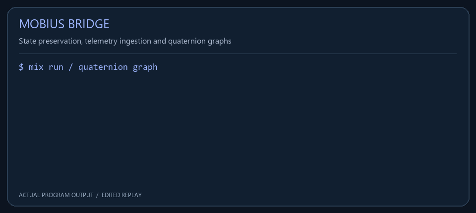
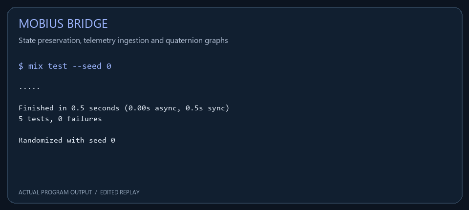

<div align="center">

# ReAct-LOOP-Jack

**State preservation, supervised telemetry ingestion, and quaternion spatial graphs.**

Lean 4 · Haskell · Elixir/OTP



<sub>Actual program output, rendered as a compact replay. Animation timing is edited.</sub>

</div>

---

 ReAct-LOOP-Jack connects a mathematical state-transition model to a native worker and an observable ingestion service. Lean expresses the preservation theorem. Liquid Haskell supplies a refinement specification and a compiler-plugin gate. The Haskell worker emits execution-state records, while the Elixir application receives, journals, validates, and exposes those records through an OTP supervision tree.

A separate binary ingestion path stores quaternion samples as a spatial graph. Textual counter telemetry and binary spatial samples retain their own formats and APIs, so neither path depends on interpreting unrelated data as the other representation.

**Navigate:** [Architecture](#architecture) · [Quick start](#quick-start) · [State model](#state-model) · [Telemetry](#telemetry) · [Spatial graph](#spatial-graph) · [Validation](#validation)

## Architecture


| Component | Responsibility | Observable result |
|---|---|---|
| Lean theorem | Specify and check cycle preservation | A checked proposition about the transition |
| Haskell worker | Apply the transition and emit records | `ROUND`, `PENDING`, and `BUDGET` lines |
| TCP receiver | Accept local streams and validate record syntax | Worker-tagged journal entries |
| Journal follower | Read appended bytes and assemble complete lines | Records dispatched to the ledger |
| Telemetry ledger | Validate each worker's state progression | Per-worker snapshots and counters |
| Spatial graph | Decode quaternion frames and update graph state | Numbered nodes and distance-weighted edges |

The Elixir application starts these runtime services through `CodexSupervisor.Application`. A task supervisor owns connection handlers; the main supervisor uses a `one_for_one` restart strategy. The receiver binds to `127.0.0.1:8080`, making the default deployment a local service.

## Quick start

### 1. Start the supervisor

Elixir 1.12 or newer is required. The Mix project has no external package dependencies.

```sh
git clone https://github.com/AHMADALIPARR/mobius-bridge.git
cd mobius-bridge/supervisor
mix test
iex -S mix
```

The application starts the TCP receiver, journal follower, ledger, and spatial graph. Keep this session running before starting the worker.

### 2. Build the worker

From the repository root:

```sh
cabal build
cabal run mobius-worker
```

The default build enables the Liquid Haskell plugin. That build requires compatible GHC, Liquid Haskell, and solver dependencies. It retains the model's disabled termination checking; a successful invariant gate is not a termination proof.

A native runtime build is also available for environments where the refinement toolchain is not installed:

```sh
cabal build -f-verify
```

Or compile directly with GHC and the `network` package:

```sh
mkdir -p .build
ghc -isrc -outputdir .build src/Main.hs -o .build/mobius-worker
.build/mobius-worker
```

This alternative exercises worker behavior without invoking the refinement checker. Keep the build mode visible in any verification report.

### 3. Inspect the state

In the running IEx session:

```elixir
DevFlowTwin.Ledger.snapshot()
CodexSupervisor.TcpReceiver.port()
DevFlowTwin.SpatialGraph.snapshot()
```

The default worker begins with 51 pending modules and budget 1. It emits 52 records, including the terminal state `ROUND:51|PENDING:0|BUDGET:52`, then closes its connection.

## State model

The state consists of three nonnegative counters:

| Field | Meaning in the model |
|---|---|
| `round` | Number of applied transitions |
| `pendingModules` | Remaining work count |
| `syntheticBudget` | Model budget counter |

The transition increments `round` and `syntheticBudget`, while decrementing `pendingModules` with saturation at zero. The invariant states that pending work implies a positive synthetic budget. The Haskell implementation uses arbitrary-precision `Integer`, avoiding machine-integer overflow in these counters.

The Lean theorem is in [lean/MobiusBridge.lean](lean/MobiusBridge.lean). The version pin in [lean-toolchain](lean-toolchain) identifies Lean 4.19.0. With that toolchain available:

```sh
lean lean/MobiusBridge.lean
```

The theorem establishes the mathematical preservation property of the defined transition. Whether a deployed system connects that model counter to an external execution budget is a separate integration question. The theorem and transition are preserved as the project's state model.

## Telemetry

The worker's wire format is a newline-delimited record:

```text
ROUND:0|PENDING:51|BUDGET:1
ROUND:1|PENDING:50|BUDGET:2
```

The receiver rejects malformed records and records violating the pending-work invariant. Accepted lines are written to a journal with a connection-specific worker identifier. The identifier allows independently progressing workers to share one journal without treating one worker's counters as another worker's next state.

The journal follower reads bounded chunks, retains incomplete records until the next read, handles truncation and file replacement, and replays from the beginning on startup. Repeated polling without new bytes does not dispatch duplicate records. Complete records reach the ledger, which checks round progression, budget increments, and saturating workload decrements for each stream.

By default, the journal is `inbox/devFlow-finance-twin/telemetry.log`. Configure the application through the `:codex_supervisor` keys `:port` and `:telemetry_path` to select a different endpoint or storage location. The journal is a local file; it does not claim cryptographic sealing or immutable storage.

## Spatial graph

The graph accepts consecutive frames of four native-endian 64-bit floating-point values. Each frame represents a quaternion `(a,b,c,d)`.

```elixir
sample = <<1.0::float-native-64, 0.0::float-native-64,
           0.0::float-native-64, 0.0::float-native-64>>

DevFlowTwin.SpatialGraph.ingest(sample)
# {:ok, [0]}

DevFlowTwin.SpatialGraph.snapshot()
```

Accepted samples become numbered graph nodes. Consecutive nodes are joined by an edge weighted with their Euclidean distance in four dimensions. Ingestion returns the assigned identifiers, and invalid binary frames leave the graph unchanged. A snapshot exposes the node map, edge map, and next identifier.

Graph state is held in memory. Telemetry state is reconstructed from its journal, but the quaternion graph does not currently have a persistence backend. Native-endian frames are suited to a known local producer; a cross-platform transport should define its byte order explicitly before using this binary interface over a network.

## Validation

The five Elixir integration tests exercise actual state changes: quaternion nodes and edge distances, invariant rejection, transition validation, partial journal records, truncation, repeated polling, interleaved workers, and delivery through the live TCP receiver.

```sh
cd supervisor
mix compile --warnings-as-errors
mix test
```

The native Haskell worker has also been executed and checked for all 52 expected records, including its terminal state. Lean 4.19.0 checked the unchanged preservation theorem. The repaired Liquid Haskell plugin build has not been independently executed; its gate remains enabled by default. Docker static linking is another build target and has not been validated in this environment.

The GitHub Actions workflow builds the native worker and runs the Elixir tests. Its runtime job does not substitute for a Liquid Haskell proof check.

<details>
<summary>View a compact test-output screenshot</summary>



The captured output used for the animation is available in [capture.json](docs/media/capture.json).

</details>

## Project layout

```text
lean/                         Mathematical state-preservation theorem
src/MobiusBridge.hs            Haskell state and refinement specifications
src/Main.hs                    TCP worker and terminal-state emission
src/Quaternion.hs              Hamilton-product implementation
supervisor/lib/codex_supervisor/ OTP application and TCP receiver
supervisor/lib/dev_flow_twin/   Ledger, journal follower and spatial graph
supervisor/config/             Application and test configuration
supervisor/test/               Runtime integration tests
docs/media/                    Small demos, diagrams and output captures
```

## License

See [LICENSE](LICENSE) for the repository's license terms.
